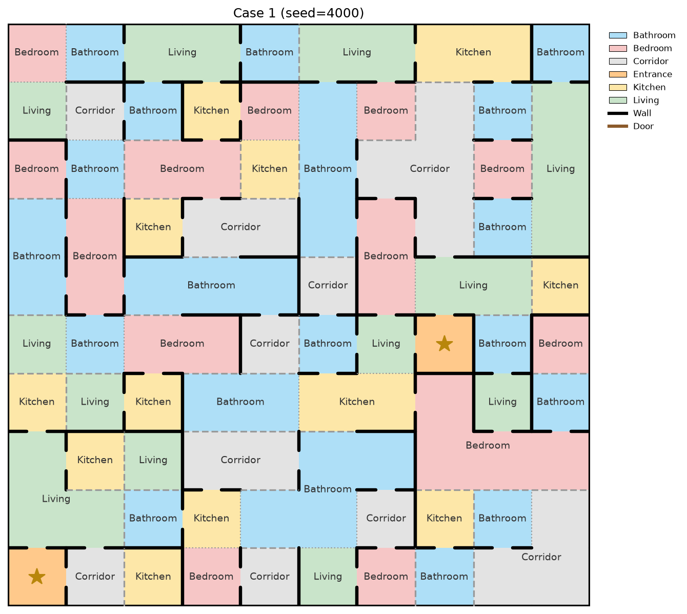
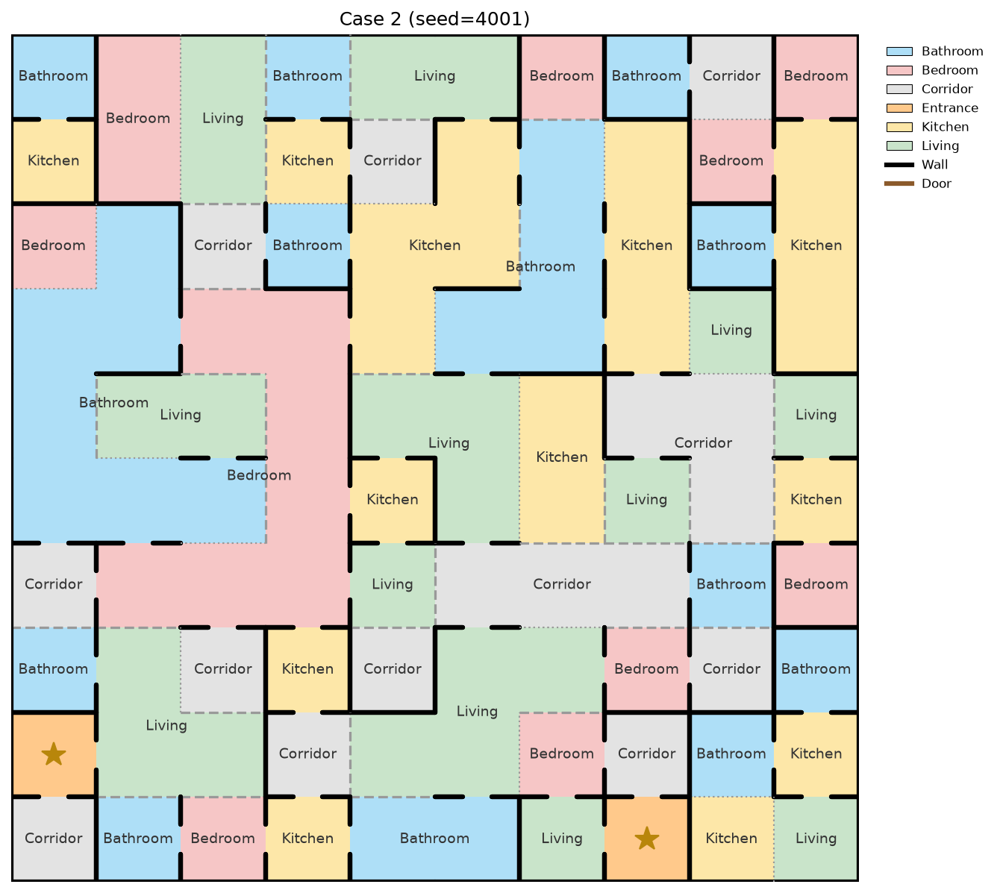
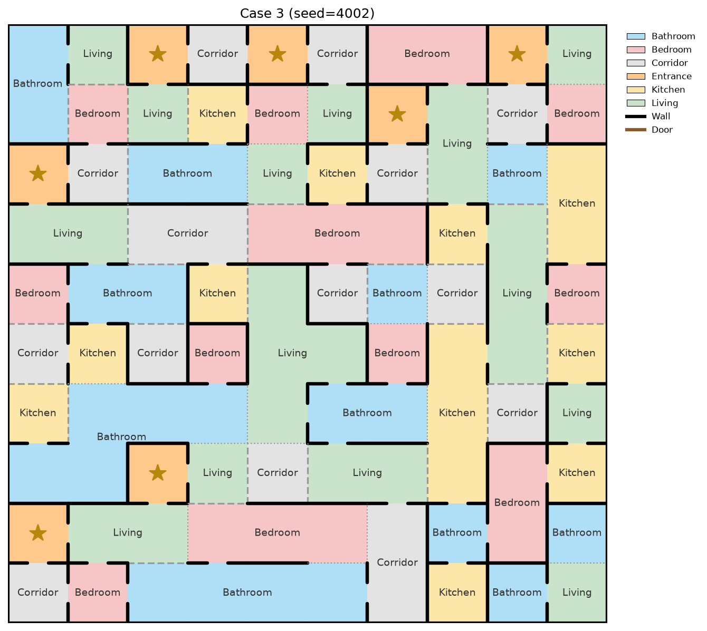
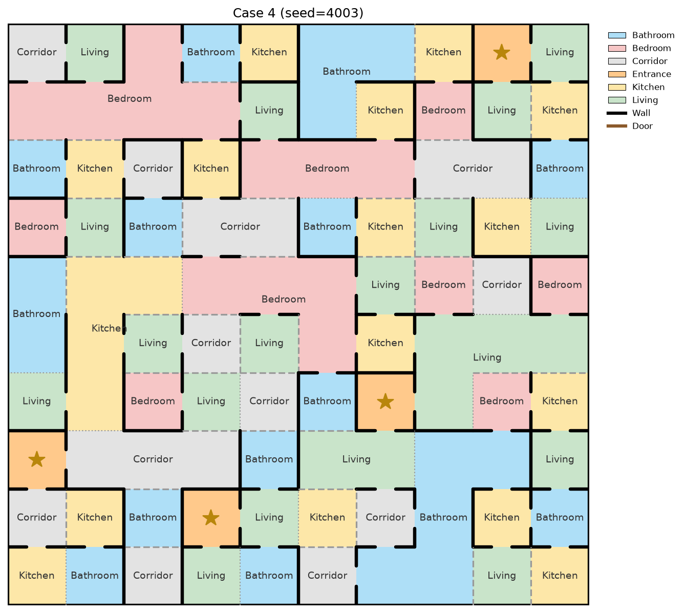
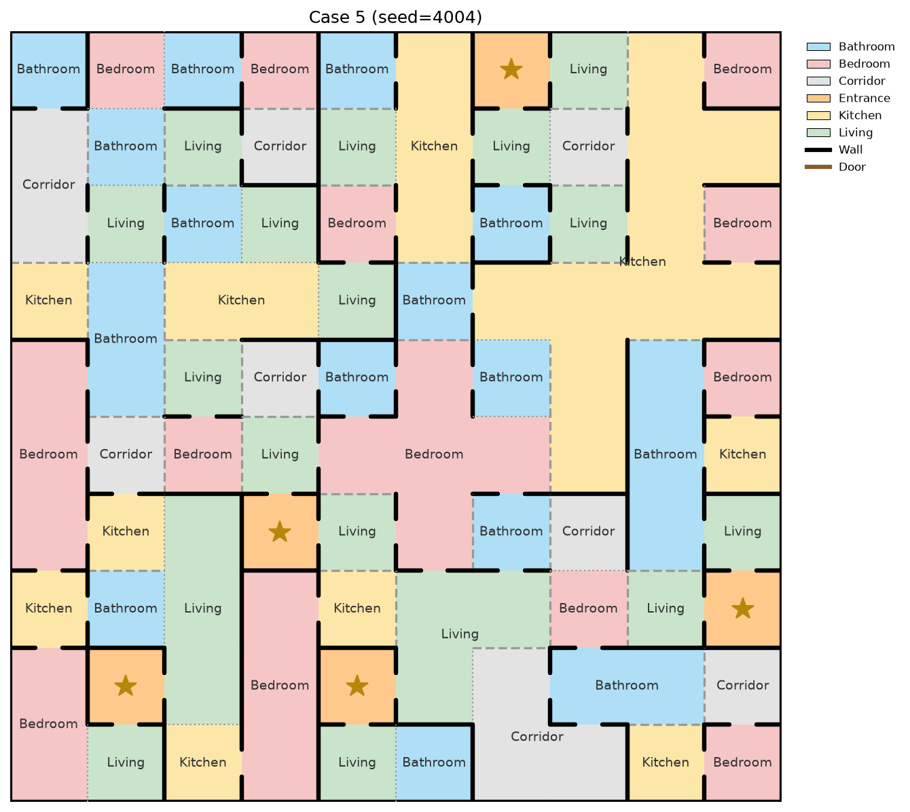

# E4 -- Qualitative Case Studies

5 plans generated at A=3, B=3, C=4 (with subcomplete tileset + Layer 2 enforcement).

Generation attempts: 5, successful cases: 5 (empirical success rate this run: 100.0%)

## Case 1 (seed=4000)

- Exterior backtracks: 0
- Structural validity: PASS
- Functional solvability: PASS (0 unreachable cells)
- Constraint satisfaction: 100.0%
- Entrance cells found: 2

## Case 2 (seed=4001)

- Exterior backtracks: 0
- Structural validity: PASS
- Functional solvability: FAIL (15 unreachable cells)
- Constraint satisfaction: 100.0%
- Entrance cells found: 2

## Case 3 (seed=4002)

- Exterior backtracks: 0
- Structural validity: PASS
- Functional solvability: FAIL (3 unreachable cells)
- Constraint satisfaction: 100.0%
- Entrance cells found: 7

## Case 4 (seed=4003)

- Exterior backtracks: 0
- Structural validity: PASS
- Functional solvability: PASS (0 unreachable cells)
- Constraint satisfaction: 100.0%
- Entrance cells found: 4

## Case 5 (seed=4004)

- Exterior backtracks: 0
- Structural validity: PASS
- Functional solvability: FAIL (4 unreachable cells)
- Constraint satisfaction: 100.0%
- Entrance cells found: 5
